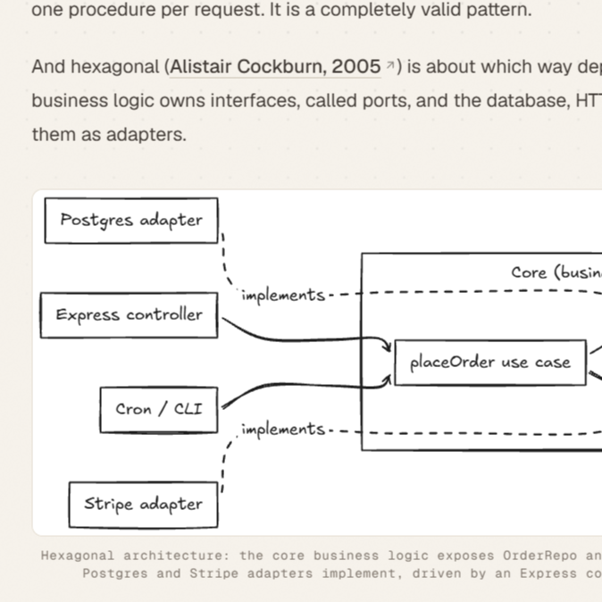
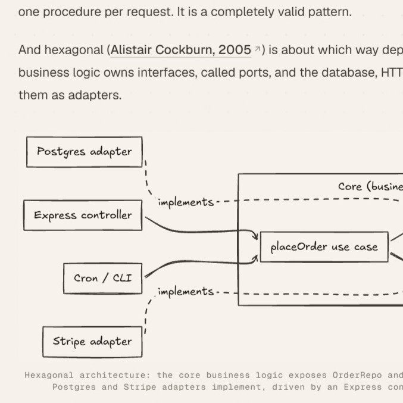
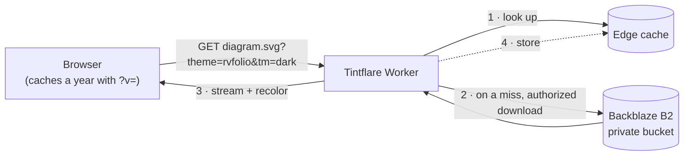

<div align="center">


&nbsp;&nbsp;&nbsp;<sub><b>+</b></sub>&nbsp;&nbsp;&nbsp;


# Tintflare

**Export once. Re-theme forever.**

A tiny Cloudflare Worker that serves files from a private Backblaze B2 bucket<br />
and re-tints SVG diagrams at the edge to match your site's theme:<br />
today's light and dark palettes, and whatever you redesign to next year. 🎨

Open source and self-hosted: it runs on your own Cloudflare and Backblaze accounts.

[](LICENSE)
[](#-contributing)
[](https://workers.cloudflare.com/)
[](https://www.backblaze.com/cloud-storage)
[](https://www.typescriptlang.org/)


[Why](#-why-tintflare) · [How it works](#%EF%B8%8F-how-it-works) · [Get started](#-get-started) · [URL API](#-url-api) · [Themes](#-themes) · [Caching](#%EF%B8%8F-caching) · [Costs](#-what-it-costs) · [Contributing](#-contributing)

</div>

---

## 👀 Before and after

One file in the bucket, exported once from Excalidraw, on a real blog page:

<table>
  <tr>
    <th width="50%">Before</th>
    <th width="50%">After</th>
  </tr>
  <tr>
    <td></td>
    <td></td>
  </tr>
  <tr>
    <td>Served as-is: a white card pasted onto a cream page.</td>
    <td>Served with <code>?theme=rvfolio&amp;tm=light</code>: the page's own paper and ink.</td>
  </tr>
</table>

## 💡 Why Tintflare

> [!NOTE]
> **The main idea:** you should never have to export the same diagram once per color scheme, and you should never have to re-export your whole archive because you redesigned your site. Your SVGs stay exactly as you drew them; the colors live in one theme file that you can change at any time.

Diagrams drawn in Excalidraw, Figma, or draw.io are exported with fixed colors: near-black ink on white. Put one on a site with a cream light theme and a warm dark theme and it looks pasted on. In dark mode it becomes a bright white card. And even if you hand-match the colors today, they go stale the day you change your palette.

The usual fixes each fall short:

| Approach | What goes wrong |
| --- | --- |
| **CSS `filter: invert(1) hue-rotate(180deg)`** | Every pixel is flipped. White turns into pure black instead of your page color, and `hue-rotate` only roughly restores hues. You can't say "this blue should become that teal," and nothing keeps text readable. |
| **Recolor in the browser with JavaScript** | An SVG in an `` is sealed: its own scripts are [disabled](https://developer.mozilla.org/en-US/docs/Web/SVG/Guides/SVG_as_an_image), and your page's CSS can't reach its shapes. So you inline the markup or fetch and rewrite it in JS. The script can be small, but the work repeats on every page view on every device. The diagram flashes in the wrong colors until the script runs, and RSS readers, email, and visitors without JavaScript never get the themed version. |
| **Export a copy per theme** | Every diagram becomes two or more files to keep in sync. The day you change your palette, every old export is out of date, and re-exporting a whole archive is exactly the chore you wanted to avoid. |
| **Tintflare** | Recolors at the edge, caches the result at Cloudflare and in the browser, and sends plain SVG with zero JavaScript. Change the palette in one file and every diagram, old and new, follows on the next deploy. |

### Why Backblaze B2 + Cloudflare Workers

Together they work like **S3 + CloudFront + Lambda@Edge**, built from free tiers:

- **B2** keeps the files in a private bucket, and **the first 10 GB of storage is free, always**. A typical Excalidraw SVG is about 20 KB, so that's room for hundreds of thousands of diagrams. Downloads to Cloudflare don't cost anything either: Cloudflare is a Backblaze CDN partner, so that egress is free, and B2 API calls are free on pay-as-you-go.
- **The Worker** authorizes with B2, fetches the file, transforms it, and caches the result. Because you own the code, you control the whole transformation, from the color math down to the cache key.

See [What it costs](#-what-it-costs) for the exact limits.

## ⚙️ How it works



The Worker signs in to B2 once and reuses that authorization for 23 hours within each Worker instance.

Each SVG streams through Cloudflare's [`HTMLRewriter`](https://developers.cloudflare.com/workers/runtime-apis/html-rewriter/), so the file is never held in memory all at once. For every paint color it finds, Tintflare:

1. **Finds the color** in presentation attributes (`fill`, `stroke`, `color`, `stop-color`, `flood-color`, `lighting-color`), in `style="…"` attributes, and in `<style>` sheets, including rules inside `@media`. Inline `background-color` is covered too, for the HTML labels that draw.io and Mermaid put inside `<foreignObject>`.
2. **Works out its role.** Fill on `<text>`/`<tspan>` is *text*, `stroke` is *stroke*, and everything else is *fill*.
3. **Uses your exact replacement** if the theme defines one for that color and role.
4. **Otherwise recolors it automatically:**
   - converts it to [OKLCH](https://bottosson.github.io/posts/oklab/)
   - flips lightness for dark mode
   - raises or lowers lightness until it meets WCAG contrast against your page background (4.5:1 for text, 3:1 for strokes)
   - gamut-maps the result back to sRGB by reducing chroma
5. **Keeps alpha** and writes the result back. Translucent colors become `#rrggbbaa`.

Everything inside `<mask>` and `<clipPath>` is left alone. Mask colors encode opacity, not paint: Excalidraw cuts the gap behind arrow labels with white and black mask rects, and recoloring them would hide or invert the arrows.

### Features

- 🎨 **Per-theme palettes**: role-wide colors, exact per-color overrides, or fully automatic recoloring
- ♿ **Contrast-aware**: automatic colors meet WCAG AA against your real page background
- 🧩 **Works with any drawing tool**: Excalidraw, draw.io, Mermaid, Figma, and anything else that writes hex (3/4/6/8 digits), `rgb()`, `hsl()`, the 148 CSS named colors, or `light-dark()`, with alpha kept
- 🌊 **Streaming**: `HTMLRewriter` transforms as bytes arrive
- 🗄️ **Cache-friendly**: normalized edge cache keys, one-year `immutable` URLs, ETags, and `304 Not Modified`
- 🔁 **Re-theme without re-exporting**: change a palette, deploy, bump `v`, and every diagram follows
- 🔒 **Private storage**: the bucket stays private; only the Worker holds the key
- 💾 **Free storage**: B2's first 10 GB is free, and B2 → Cloudflare egress is free
- ⏱️ **Observable**: a `Server-Timing` header on every response
- 🪶 **Zero runtime dependencies**

## 🚀 Get started

### 1. Set up Backblaze B2

1. Create a **private** B2 bucket and upload your files. Object keys become URL paths: `blog/diagram.svg` is served at `/blog/diagram.svg`.
2. Create an **application key** limited to that bucket. *Read Only* is enough.
3. Keep these three values handy. They become the Worker's secrets:

| Secret | Value |
| --- | --- |
| `B2_ACCOUNT_ID` | The application **key ID** (the Basic auth username), not the 12-digit account ID |
| `B2_APPLICATION_KEY` | The application key |
| `B2_BUCKET_NAME` | The bucket name |

Then deploy either from the Cloudflare dashboard (nothing to install) or from your machine.

### 2a. Deploy from the Cloudflare dashboard (no local setup)

All you need is a GitHub account and a Cloudflare account.

1. **Put the code in your GitHub account**, by forking or pushing this repository.
2. **Import it:** in the [Cloudflare dashboard](https://dash.cloudflare.com/), go to **Workers & Pages** → **Create application** → **GitHub**, authorize GitHub if asked, and pick the repository.
3. **Configure the build:**

   | Setting | Value |
   | --- | --- |
   | Worker name | `tintflare`. It must match `name` in [`wrangler.jsonc`](wrangler.jsonc), or the build fails, so change both if you want another name. |
   | Build command | Leave empty. Wrangler bundles the TypeScript itself. |
   | Deploy command | `npx wrangler deploy` |

   > [!WARNING]
   > Use `npx wrangler deploy`, not `npm run deploy`. The npm script uploads secrets from a local `.env` file, which doesn't exist in Cloudflare's build, so the build would fail.

4. **Select Save and Deploy.** The Worker goes live at `https://tintflare.<your-subdomain>.workers.dev`. Until you add the secrets, it answers `Worker is not configured correctly`. That's expected.
5. **Add the keys:** open the Worker → **Settings** → **Variables and Secrets** → **Add**. Add `B2_ACCOUNT_ID`, `B2_APPLICATION_KEY`, and `B2_BUCKET_NAME`, each with type **Secret**, then select **Deploy**.
6. **Try it:** open `https://tintflare.<your-subdomain>.workers.dev/<path-to>.svg?tm=dark`. 🎉

From now on, every push to your production branch deploys automatically. Pushes to other branches create [preview deployments](#-preview-deployments), which need their own copy of the secrets.

### 2b. Run and deploy from your machine

**You need:** Node.js 22+.

```bash
git clone https://github.com/rajv4rdhan/Tintflare.git
cd Tintflare
npm install
cp .env.example .env    # fill in the three B2 values
npm run dev
```

Wrangler serves the Worker at <http://localhost:8787> and loads `.env` automatically. Try `http://localhost:8787/<path-to>.svg?tm=dark`.

To deploy:

```bash
npx wrangler login
npm run deploy
```

`npm run deploy` type-checks, builds, uploads `.env` as Worker secrets, and deploys. To set one secret at a time instead, run `npx wrangler secret put B2_ACCOUNT_ID`.

If the Worker answers `Worker is not configured correctly`, its B2 secrets are missing. `wrangler tail` logs which ones.

### 3. Change your theme later

This is the part Tintflare exists for. When you redesign:

1. Edit the palette in [`src/themes/`](src/themes) and deploy.
2. Bump the `v` your site puts in image URLs, for example `v=2` → `v=3`.

Every diagram in the bucket, old and new, now uses the new colors. You don't re-export a single file.

## 🔗 URL API

Any object in the bucket is served at its key. `/` and paths ending in `/` serve `index.html`. A missing file serves the bucket's `404.html`, or a built-in fallback page. SVGs accept these query parameters:

| Parameter | Values | Effect |
| --- | --- | --- |
| `theme` | A registered theme name (`default`, `rvfolio`, …) | Which palette to use. Defaults to `default`. |
| `tm` | `light` · `dark` | Theme mode. Defaults to `light`. |
| `cvd` | `deutan` | Simulates deuteranopia before recoloring (see [Limitations](#-limitations)). |
| `v` | Up to 64 letters, digits, `.`, `-`, `_` | A cache-busting version. Any `v` makes the response cacheable for a year. |

Values are case-insensitive. An unknown `theme` or `tm`, or a malformed `v`, returns `400 Bad Request` so typos fail loudly. Without `theme`, `tm`, or `cvd`, an SVG is served exactly as stored.

### Using it on a site

**If your site follows the OS theme**, let the browser choose:

```html
<picture>
  <source media="(prefers-color-scheme: dark)"
          srcset="https://cdn.example.com/diagram.svg?theme=mysite&tm=dark&v=1" />
  
</picture>
```

**If your site has its own theme toggle** (for example, a `.dark` class on `<html>`), `<picture>` can't follow it. Render both images and hide one with CSS:

```html


```

```css
.dark .light-only,
:root:not(.dark) .dark-only { display: none; }
```

Browsers generally put off loading lazy images that aren't displayed, so each reader downloads only one variant.

## 🎨 Themes

Themes live in [`src/themes/`](src/themes) and are registered in [`src/themes/index.ts`](src/themes/index.ts). Each theme name is also its `?theme=` value.

| Theme | Light background | Dark background | Style |
| --- | --- | --- | --- |
| `default` | `#ffffff` | `#0f172a` | Fully automatic recoloring |
| `rvfolio` | `#f7f3ec` | `#181716` | The author's hand-picked palette for Excalidraw diagrams on a warm paper-and-ink blog. A worked example to copy. |

### What a theme controls

```ts
export interface ThemeDefinition {
  background: string;                          // exact page color; white fills become this
  minContrast: { text: number; stroke: number; fill: number };
  colors?: { text?: string | null; stroke?: string | null; fill?: string | null };
  overrides?: Record<string, string | null | { text?: …; stroke?: …; fill?: … }>;
}
```

For each color, the first rule that matches wins:

1. `overrides[source][role]`: an exact replacement for this color in this role
2. `overrides[source]` as a string: an exact replacement for every role
3. `colors[role]`: a replacement for every color in this role
4. A white fill becomes `background`
5. Automatic OKLCH recoloring with contrast enforcement

`null` keeps the original color. Overrides match by **value**, not spelling: a key of `'#fff'` also matches `#ffffff`, `white`, and `rgb(255 255 255)`.

> [!IMPORTANT]
> Overrides and `colors` are written exactly as you give them and **skip** automatic contrast checks. Check them against your background. [`rvfolio.ts`](src/themes/rvfolio.ts) notes each ratio inline.

### Adding a theme

```ts
// src/themes/mysite.ts
import type { ThemeCollection } from './types';

export const mysiteTheme = {
  light: {
    background: '#f7f3ec',
    minContrast: { text: 4.5, stroke: 3, fill: 0 },
    overrides: {
      '#1e1e1e': { text: '#1b1815', stroke: '#3f3934' }, // Excalidraw ink
      '#e03131': '#b23a16',                              // red → brand accent
    },
  },
  dark: {
    background: '#121110',
    minContrast: { text: 4.5, stroke: 3, fill: 0 },
    overrides: {
      '#1e1e1e': { text: '#f1ece4', stroke: '#d3ccc2' },
      '#e03131': '#f0642d',
    },
  },
} satisfies ThemeCollection;
```

Then register it:

```ts
// src/themes/index.ts
export const THEMES = {
  default: { light: lightTheme, dark: darkTheme },
  rvfolio: rvfolioTheme,
  mysite: mysiteTheme,
} satisfies Record<string, ThemeCollection>;
```

<details>
<summary><b>Excalidraw's standard colors</b> (handy override keys)</summary>

| Source | Excalidraw use |
| --- | --- |
| `#1e1e1e` | Default ink for text and strokes |
| `#e03131` | Red stroke |
| `#2f9e44` | Green stroke |
| `#1971c2` | Blue stroke |
| `#f08c00` | Orange stroke |
| `#ffc9c9` | Red fill |
| `#b2f2bb` | Green fill |
| `#a5d8ff` | Blue fill |
| `#ffec99` | Yellow fill |
| `#ffffff` | Canvas background and white fills |

</details>

> [!TIP]
> Export from Excalidraw with **Background** turned off if your site has a textured or patterned background. The diagram then sits directly on the page instead of on a flat rectangle.

## 🗄️ Caching

| Request | `Cache-Control` |
| --- | --- |
| Without `v` | `public, max-age=86400` (1 day) |
| With `?v=<token>` | `public, max-age=31536000, immutable` (1 year) |

- **Bump `v` whenever the output changes.** That includes a new palette or a re-uploaded file. Browsers never re-check an immutable URL.
- **Normalized cache keys.** The edge cache key is the path plus only the parameters that change the output (`theme`, `tm`, `cvd`, `v`), normalized and in a fixed order. `?tm=DARK&theme=rvfolio&utm_source=x` and `?theme=rvfolio&tm=dark` share one entry, so stray query strings can't force refetches from B2.
- **Deploys refresh themed SVGs.** Their cache keys include the deployed Worker version (the `CF_VERSION_METADATA` binding), so a deploy never serves output from older code.
- **ETags and 304s.** A matching `If-None-Match` gets `304 Not Modified`:

  | Response | `ETag` |
  | --- | --- |
  | File as stored | B2's SHA-1 of the file, or its file ID if B2 has no SHA-1 |
  | Themed SVG | A hash of the source tag, theme, mode, `cvd`, and deployed version |

## 🔍 Observability

Every response carries `Server-Timing`, visible in DevTools → Network → Timing:

```text
cache;desc=MISS, total;dur=8.0
cache;desc=HIT, total;dur=2.0
```

`cache` is `HIT`, `MISS`, or `BYPASS` (non-GET). Themed SVGs are streamed, so `total` is the time until the response starts, not until the last byte. Workers freeze timers during synchronous work, so a separate CPU timing for the transform would always read zero.

## 🧪 Preview deployments

With [Workers Builds](https://developers.cloudflare.com/workers/ci-cd/builds/), pushes to non-production branches run `wrangler preview`. That command needs the `previews` block in [`wrangler.jsonc`](wrangler.jsonc), which is already there.

Previews don't inherit your production secrets. Set the B2 secrets once for all future previews:

```bash
npx wrangler preview base-config secret put B2_ACCOUNT_ID
npx wrangler preview base-config secret put B2_APPLICATION_KEY
npx wrangler preview base-config secret put B2_BUCKET_NAME
```

Base secrets apply to previews created **after** you set them. To fix an existing preview, run `npx wrangler preview secret put <NAME> --name <preview>`.

## 💸 What it costs

A personal site can usually run Tintflare for free. Figures checked in October 2026; see [B2 pricing](https://www.backblaze.com/cloud-storage/pricing) and [Workers limits](https://developers.cloudflare.com/workers/platform/limits/) for current numbers.

| | Free allowance | Beyond it |
| --- | --- | --- |
| **B2 storage** | First 10 GB, always (hundreds of thousands of ~20 KB diagrams) | From $6.95 per TB per month |
| **B2 → Cloudflare egress** | Free (Cloudflare is a Backblaze CDN partner) | Free |
| **B2 API calls** (authorize, download) | Free on pay-as-you-go | Free |
| **Workers requests** | 100,000 per day, 10 ms CPU per request (Free plan) | Workers Paid plan |

Two things count against your Workers quota:

- **Every request to the Worker counts, including edge-cache hits.** The cache saves B2 trips and CPU time, not requests.
- **On the Free plan, requests past 100,000 a day get Cloudflare error 1027.** What visitors then see depends on your route's fail mode.

The best way to keep the count low is browser caching: with `?v=`, each reader fetches a diagram once a year.

## 🚧 Limitations

- **`cvd=deutan` simulates, it doesn't fix.** It applies the Viénot–Brettel–Mollon deuteranopia matrix, so you can preview roughly what someone with deuteranopia sees. It doesn't adjust colors to be safer. Colors matched by `overrides` or `colors` skip it.
- **Inherited fills aren't followed.** Roles are decided per element, so `<g fill="…">` around `<text>` is treated as a shape fill. Excalidraw puts `fill` on `<text>` directly, so its exports are unaffected.
- **Some values are left as they are:** `var(…)`, `currentColor`, `transparent`, `url(#…)`, and colors inside gradients referenced by URL. Gradient `stop-color`s are recolored as fills.
- **Role detection in `<style>` sheets is name-based.** A rule whose selector names `text`, `tspan`, or `textPath` counts as text.
- **`HEAD` requests** for a themed URL return the stored file's headers, not the themed one's.
- **Only `GET` and `HEAD` are allowed.** Anything else gets `405`.

## 🗺️ Ideas on the roadmap

Each of these would make a good first contribution. Open an issue to claim one or discuss the design first.

- [Workers Cache](https://developers.cloudflare.com/workers/cache/) in front of the Worker, so hits skip the code entirely
- `?format=png` for RSS readers, email, and social cards, which can't show SVG
- `?tm=vars` output that uses CSS custom properties, so inlined SVGs follow the site's own color tokens
- An optional draw-in animation for hand-drawn strokes, behind `prefers-reduced-motion`
- A checker endpoint that reports contrast failures and colorblind-confusable pairs before you publish

## 🛠️ Development

| Script | What it does |
| --- | --- |
| `npm run dev` | Run the Worker locally with Wrangler |
| `npm run typecheck` | Type-check with TypeScript |
| `npm run build` | Bundle into `dist/` with a dry-run deploy |
| `npm run deploy` | Type-check, build, upload secrets, deploy |
| `npm run secrets` | Upload `.env` values as Worker secrets |
| `npm run cf-typegen` | Regenerate `worker-configuration.d.ts` |

<details>
<summary><b>Project layout</b></summary>

```text
docs/
  images/               Screenshots used in this README
src/
  index.ts              Entry point: method check, error handling, Server-Timing
  config.ts             Environment validation and typed configuration
  env.d.ts              Worker environment types
  handlers/
    assets.ts           Asset requests, cache keys, ETags, 304s
    not-found.ts        Custom and fallback 404 pages
  lib/
    cache.ts            Cache API helpers and normalized cache keys
    color.ts            Color parsing, OKLCH, gamut mapping, contrast
    http.ts             Response builders and cache headers
    named-colors.ts     CSS named color table
    paths.ts            URL path → B2 object key
    server-timing.ts    Server-Timing collector
    svg-theme.ts        Streaming SVG recoloring with HTMLRewriter
  themes/
    index.ts            Theme registry
    types.ts            Theme types
    light.ts, dark.ts   The default theme
    rvfolio.ts          rvfolio palette
    cvd.ts              Color vision deficiency matrices
  services/
    backblaze.ts        B2 authorization and downloads
```

</details>

## 🤝 Contributing

Contributions of every size are welcome: a typo fix, a new theme, a bug report with a tricky SVG. 💛

### Reporting a bug

[Open an issue](https://github.com/rajv4rdhan/Tintflare/issues/new) with:

- the SVG, or a minimal snippet of it, that recolors wrongly
- the full URL you requested, including the query string
- what you expected and what you got (screenshots help a lot)

### Sending a pull request

1. Fork the repository and create a branch from `main`.
2. Run it locally with `npm install` and `npm run dev` (see [Run and deploy from your machine](#2b-run-and-deploy-from-your-machine)).
3. Keep the change focused, and match the existing code style: small functions, JSDoc on anything non-obvious.
4. Run `npm run typecheck` and `npm run build`. Both must pass.
5. If you change how colors are transformed, add a before/after screenshot of a real diagram to the PR.
6. If you change behavior, update this README in the same PR.

### Sharing a theme

Themes are plain TypeScript files, so a PR that adds a well-tuned palette for a popular site style is very welcome. Please note the contrast ratio of each override against its background, the way [`rvfolio.ts`](src/themes/rvfolio.ts) does.

### Security

Please don't report security problems in a public issue. Use **Security → Report a vulnerability** on the GitHub repository to report them privately.

## 📄 License

[MIT](LICENSE) © 2026 Rajvardhan. Use it, fork it, and make your diagrams match your site. 🎨

## 🙏 Acknowledgements

- [Oklab and OKLCH](https://bottosson.github.io/posts/oklab/) by Björn Ottosson, for the color math
- Viénot, Brettel & Mollon (1999), for the deuteranopia simulation matrix
- [Excalidraw](https://excalidraw.com/), for the diagrams that started all this
- Logos from [Simple Icons](https://simpleicons.org/). Cloudflare and Backblaze are trademarks of their respective owners; this project isn't affiliated with either.

<div align="center">
<sub>Made with ☕, OKLCH, and an unreasonable number of hex codes.</sub>
</div>
